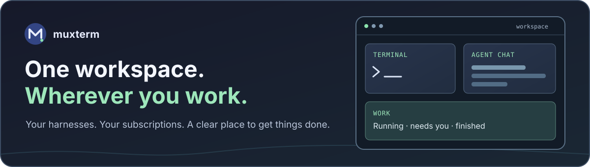
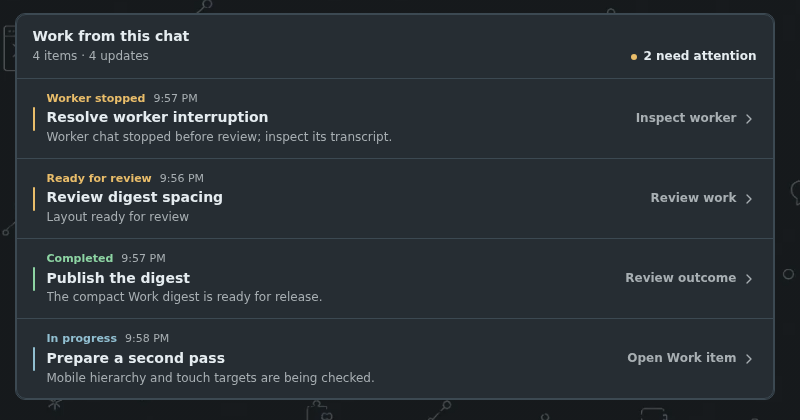
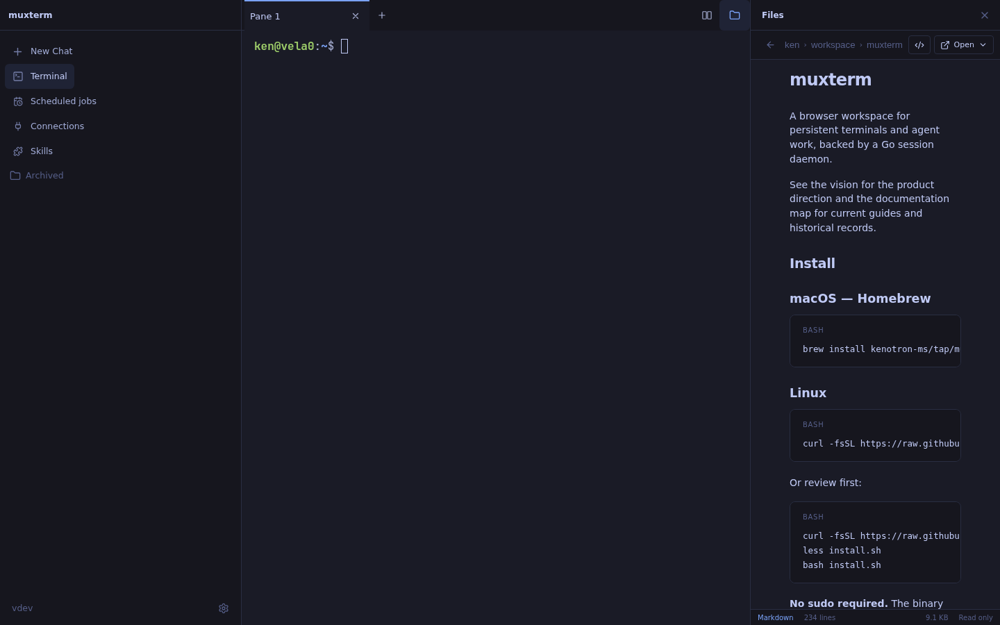

<p align="center">
  <picture>
    <source media="(max-width: 640px)" srcset="docs/marketing/workspace-mobile.svg">
    
  </picture>
</p>

# muxterm

**Use the harnesses and subscriptions you already have. Get one inviting place to work, wherever you are.**

Muxterm brings Codex, Claude Code, and Amplifier sessions together with persistent terminals, files, and trackable Work. Open the same responsive workspace at your desk or on your phone: the status stays clear, and the calm, palette-derived interface leaves room for the task.

[Get started](#get-started) · [See the workflow](#a-good-first-workflow) · [Explore the features](#what-you-can-do) · [Download a release](https://github.com/kenotron-ms/muxterm/releases/latest)

[Website](https://kenotron-ms.github.io/muxterm/) · [Documentation](https://kenotron-ms.github.io/muxterm/docs/) · [Storybook](https://kenotron-ms.github.io/muxterm/storybook/)

## Why use muxterm?

- **Bring your own agent setup.** Keep using the harnesses, accounts, models, and subscriptions you already chose. Terminal work needs no AI provider at all.
- **Return to useful context.** A Go session daemon owns the real PTYs, so browser disconnects and web-server restarts do not end your shells. It restores screen state when you reconnect, including full-screen terminal apps.
- **See the work, not just the chat.** Agent sessions have durable history and status. Work records keep outcomes, owners, blockers, and evidence visible; a scheduler can give filed work to a suitable session.
- **Take the same workspace with you.** Use the browser or install the PWA on desktop and phone. Connect project machines over SSH through one home Muxterm URL when your work spans hosts.

## Get started

**macOS**

```bash
brew install kenotron-ms/tap/muxterm
muxterm
```

**Linux**

```bash
curl -fsSL https://raw.githubusercontent.com/kenotron-ms/muxterm/main/install.sh | bash
muxterm
```

The local command opens Muxterm in your browser. The Linux installer can also be [downloaded and reviewed before running](docs/guides/installation-and-updates.md#linux); it installs under your home directory without `sudo`. Prebuilt binaries, the macOS desktop app, and the Android client are on [GitHub Releases](https://github.com/kenotron-ms/muxterm/releases/latest). You can use terminals and workspaces immediately; agent chats need the corresponding harness installed and signed in.

| To use | Set up your existing account |
| --- | --- |
| Codex | Install Codex and run `codex login`. |
| Claude Code | Install Claude Code and run `claude` to sign in. |
| Amplifier | [Install Amplifier](https://github.com/microsoft/amplifier-app-cli#installation) and run `amplifier init` to select a provider and model. |

See [installation, service mode, and updates](docs/guides/installation-and-updates.md) for more options. An AI provider is optional for terminal use.

## A good first workflow

1. **Open Terminal** for your shell, editor, or TUI. Split panes when you want tools side by side; Muxterm keeps the PTYs running when the browser goes away.
2. **Start a chat in a project folder.** Choose the harness and model you already use. Its conversation remains a session you can find again, rather than a terminal pane you must remember.
3. **File a Work item for an outcome.** Describe what done means. Muxterm records the criteria, chooses an eligible worker session when the item is ready, and shows progress, blockers, and evidence in Work.
4. **Keep the relevant surfaces nearby.** Browse and preview project files beside the conversation, or schedule a Job for recurring instructions.
5. **Pick up from another screen.** Once you have configured a reachable home Muxterm URL, open it on your phone or another computer to inspect the session and its next action.

| When you want to… | Use |
| --- | --- |
| Run commands or a full-screen terminal app | **Terminal** — persistent real PTYs and flexible panes |
| Work with your coding agent | **Chats** — native harness sessions and their history |
| Delegate and follow an outcome | **Work** — durable criteria, dispatch, progress, and evidence |
| Inspect the project alongside a session | **Files** — browse, search, and preview without leaving the workspace |
| Repeat standing instructions | **Scheduled jobs** — versioned instructions and run history |

## What you can do

**Keep terminals alive.** Named workspaces and resizable splits are backed by a standalone session daemon. Reconnection replays a cell-grid screen snapshot instead of relying on a raw byte stream, so tools such as vim and htop return at the current window size. The browser UI runs on Lit, dockview, and xterm.js.

**Work across harnesses.** Muxterm starts and tracks supported coding agents with native session lifecycle reporting. Chats and their history are first-class, whether or not a terminal is attached. A persistent Operator conversation and Work view help you understand the whole fleet. [Read the session model](VISION.md).

**Keep the project in view.** The Files pane can browse and preview files beside a terminal or chat.

**Move between machines.** A home Muxterm URL can connect to projects and agent sessions on SSH machines while their files, processes, and sign-ins stay there. [Set up remote projects](docs/guides/remote-projects-and-chats.md).

**Connect your other tools.** `muxterm mcp` exposes workspace, terminal, file, and other controls to MCP-compatible agents. The macOS app also has a local browser pane that agents can inspect and operate through its native MCP tool. [See agent integration and permission boundaries](docs/guides/agent-integration.md).

<p align="center">
  
</p>
<p align="center"><em>Work status stays visible in the conversation; details live in the Work view.</em></p>

<details>
<summary>See Terminal and Files side by side</summary>



</details>

## How it works

```text
Browser / PWA / client
       ↕ WebSocket
Muxterm Go server — chats, Work, files, and web UI
       ↕ Unix socket
sessiond — real PTYs, screen state, and workspace lifecycle
       ↕
your shells
```

Muxterm is self-hosted. The server handles the web UI, authentication, and chat coordination; `sessiond` owns terminal state independently of the browser and HTTP server. Agent harnesses use their own installed tooling and credentials. See [the architecture](ARCHITECTURE.md), [vision](VISION.md), and [documentation map](docs/README.md).

## Build and contribute

From source, `make build` produces the embedded web UI and Go binary. For isolated local development use `make dev-local`; it serves on `127.0.0.1:8313`. See [development setup](docs/guides/installation-and-updates.md#development) and read [AGENTS.md](AGENTS.md) before running verification on a machine with Muxterm installed.

Muxterm is [MIT licensed](LICENSE).
