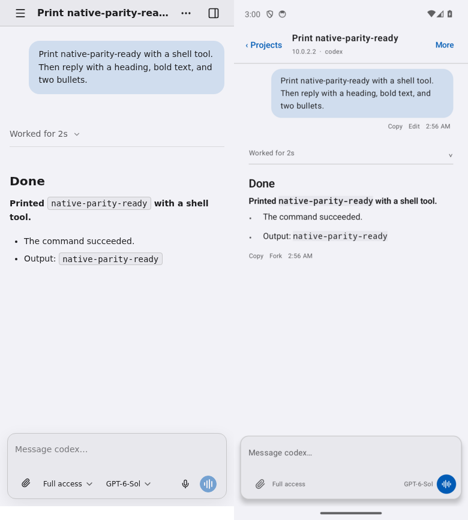

# Android satellite chat storyboard

This capture compares the current web SDK chat on `origin/main` (left) with the
native Android satellite (right). Both show the same chat on an isolated
`make dev-local` server. The web capture uses the light chrome tokens so the
surfaces can be compared directly.

| Moment | What the person sees | Native behavior |
| --- | --- | --- |
| Open a project | Projects and chats are grouped under their server node. | Select a chat or create a project folder and first chat on a connected node. |
| Compose | One raised composer with attachment, permission, model, and the primary action. | Text grows in place; files are picked with Android's file picker; speech recognition fills a draft. |
| Work is running | The work summary updates in the transcript. | New text becomes a steering message. An empty draft leaves Stop as the primary action. |
| Review the result | User input is a tinted bubble; the assistant reply is plain Markdown. | Expand work for tools, notes, and interjections; copy, edit, fork, open attachments, or answer a question. |

The screenshot is a visual parity check, not a promise of identical system
chrome or font rasterization. The Android status and navigation bars remain
native. Chat state, actions, and labels are defined in
[chat-presentation-vocabulary.md](chat-presentation-vocabulary.md).
