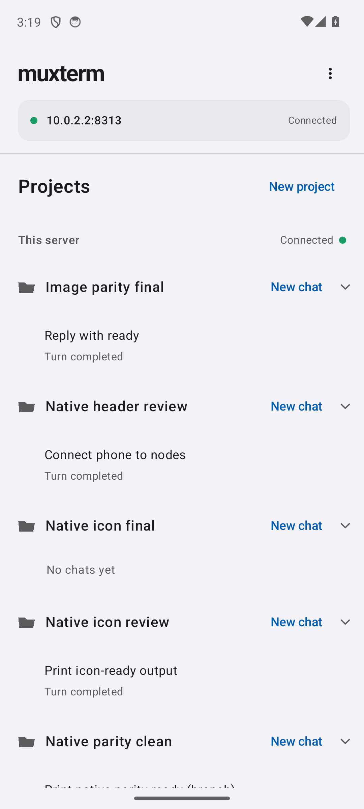
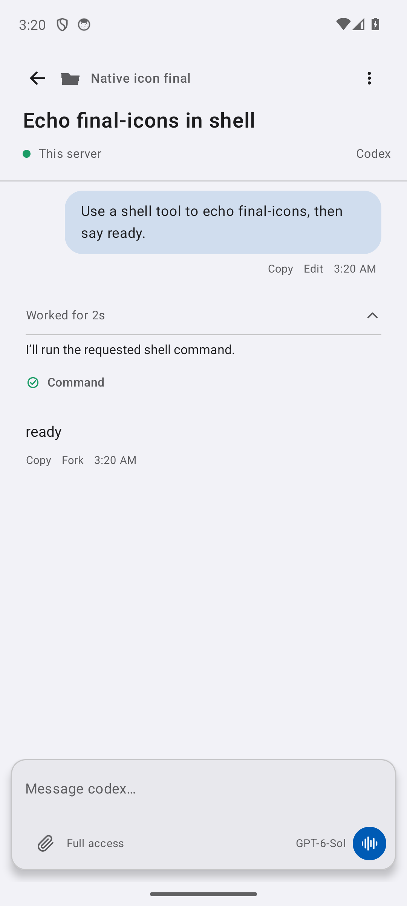

# Native Android chat storyboard

The Android satellite presents projects and SDK chats with native Compose
components. These captures are from an Android 14 emulator connected to an
isolated muxterm server.

## Find a project

The first screen shows the connected server, its project groups, and each
chat's recent state. The server address opens native connection settings.
The overflow menu offers the web workspace and server settings.

## Continue a chat

The chat header keeps the project and node visible while giving the chat
title its own line. A green dot marks the connected node. The agent label
sits opposite it. The overflow menu carries the secondary actions.

| Moment | Native behavior |
| --- | --- |
| Compose | Enter text in the raised composer, attach a file, adjust chat controls, or dictate into the draft. |
| Work is running | Expand work to see tool activity and interjections. Text in the composer steers the active turn; an empty composer offers Stop. |
| Review the result | User input is a tinted bubble; the assistant reply uses native Markdown. Copy, edit, fork, open attachments, or answer a question from the transcript. |

The event-to-UI terms are defined in
[chat-presentation-vocabulary.md](chat-presentation-vocabulary.md).
