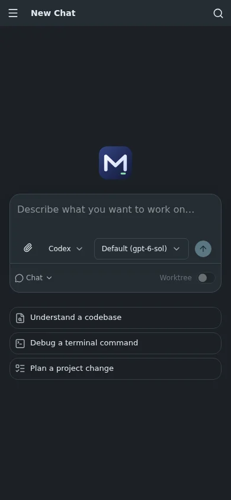

# Start your first chat

Pick a small, familiar project, like planning a workshop or organizing research notes. A clear first request helps you see what an agent can do before handing it more work.

## Choose a project and agent

1. Open **New chat** from the sidebar.
2. Use the location picker to choose a project folder. You can select an existing folder or create a new one. Keeping related chats in one folder makes them easier to find.
3. Choose an agent next to the message box. If the list is empty, [connect an agent](installation.md).
4. Write a request and send it. For example:

> Help me outline a 45-minute workshop for people new to our team. Ask me what you need to know first. Then suggest an agenda and flag anything I’ll need to prepare.

## Keep context nearby

- **Attach a file** using the attachment button below the message box if the agent needs a specific document or image.
- **Open Files** from the chat’s utility area to browse or preview project files alongside the conversation.
- **Reopen a conversation** from the sidebar to pick up where you left off. Use **New chat** in the same project when you want a separate conversation for a different task.

Once you have a plan, [hand off a task and follow the result](work.md).
