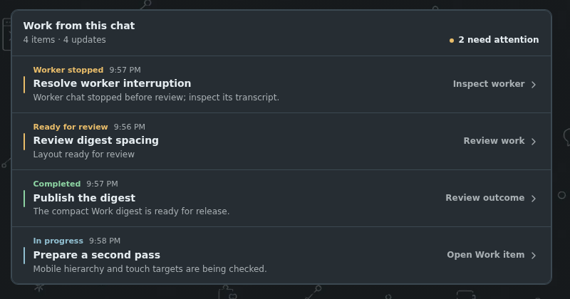

# Delegate and review work

Use a chat to explore an idea. When you have a task with a clear result, turn it into a **Work** item so you can follow it from brief to review. Muxterm can start a separate worker chat for an eligible item when the project is running.

## Draft a task in chat

In a project chat, tell your agent what you want delivered and ask to review the task before it starts. For example:

> Draft a Work item for a one-page workshop handout. It should include the agenda, what participants will learn, and three discussion questions. Save it in this project. Let me review the Work draft before starting.

Start with one task. For a larger project, give each independent piece a clear deliverable. If one piece needs the result of another, say so in your request.

## Review and start

1. Open the draft from the chat or select it in the project’s **Work** view.
2. Read the brief and check what the worker will treat as done. Ask your chat to revise anything unclear.
3. Select **Approve & start** when you’re ready. Use **Approve only** to review now and start later.

If an item stays ready without starting, check whether the project is paused, a prerequisite is unfinished, or an agent needs setup.

## Check the result

Open **Work** to see progress and find the worker’s conversation. If the agent needs a decision, open its chat and respond. When the result is ready, open the deliverable and compare it with the original brief. Use **Mark complete** if the item still needs your sign-off and the result meets the brief.

You can leave the chat and return to the same Work item later. [Open Muxterm on another screen](remote-projects.md) to check in from a different device.
